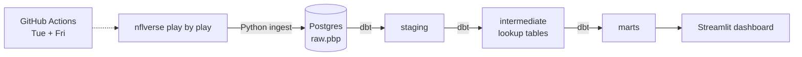

# 4th Down Audit

How much expected value do NFL head coaches leave on the field with their 4th down decisions?

This project grades every 4th down since 2010 (about 65,000 decisions) by comparing what the coach did with the option that had the highest expected points. It refreshes automatically twice a week during the season, so the current year's leaderboard stays live.

**Live dashboard:** _link coming soon_

## What it shows

* **Coach leaderboard:** expected points lost per game, compared with the league average that same season, for one season or a whole career.
* **Aggression vs cost:** how often each coach goes for it when going is the better call, against how much value they give up.
* **League trend:** coaches went for it in about 14% of "should go" spots in 2010 and about 37% in 2025, and the value left on the field fell by roughly 40% over the same period.
* **Decision explorer:** every graded 4th down for a coach and season, with the value of each option and the play description.

## Architecture



| Layer | Tool | What it does |
|---|---|---|
| Ingest | Python (`nflreadpy`, `polars`, `psycopg2`) | Loads each season from nflverse and replaces it in `raw.pbp` with a bulk `COPY`. Reruns are safe. |
| Storage | PostgreSQL (Neon free tier in production, Docker locally) | About 800K plays from 2010 on, around 200 MB. |
| Transform | dbt | Staging view, five intermediate lookup tables, six marts, and 12 data tests. |
| Dashboard | Streamlit + Plotly | Reads only from the marts. |
| Orchestration | GitHub Actions | Refreshes the current season and rebuilds the models every Tuesday and Friday. |

## How a decision is graded

Each 4th down has up to three options, all valued in **expected points (EP)**, using nflverse's EP values:

| Option | Expected points |
|---|---|
| Go for it | conversion rate × EP after converting + (1 − conversion rate) × EP after a turnover on downs |
| Field goal | make rate × (3 − EP the opponent gets from the kickoff) + miss rate × EP after a miss |
| Punt | average EP after real punts from that yard line |

All of the lookup tables are built in SQL from the data itself:

* `int_ep_curve`: EP of a fresh 1st down at every yard line, smoothed over five yards.
* `int_go_conversion_rates`: 3rd and 4th down conversion rates by distance, field zone, and era. Third downs are included because teams almost always go for it on 3rd down, which removes most of the selection bias in 4th down attempts.
* `int_go_success_value`: EP after a successful conversion.
* `int_fg_make_rates`: field goal make rate by distance and era (60 yard attempts went from about 36% in 2010 to 2014 to about 61% since 2024).
* `int_punt_values`: EP after punting from each yard line.

**EP lost** is the gap between the best option and the coach's choice. Only competitive situations are graded: win probability between 10% and 90% and more than two minutes left in the half, since expected points ignores the clock and score.

Career and season rankings use **EP lost per game relative to the league average that season**, so a coach from 2012 is not penalized for coaching before the league became more aggressive.

### Limits

* Expected points does not account for score or time inside the graded window.
* Rates are league averages and do not know about a specific offense, kicker, or weather.
* Fake punts and fake field goals count as going for it.

## Run it locally

```bash
docker compose up -d db
docker compose run --rm pipeline python ingest/load_pbp.py --start 2010
docker compose run --rm pipeline sh -c 'export $(python scripts/pg_env.py | xargs) && cd dbt && dbt build --profiles-dir .'
docker compose up dashboard        # http://localhost:8501
```

## Deploy

1. Create a free Neon project and copy its connection string.
2. Add it to this repo as an Actions secret named `DATABASE_URL`.
3. Run the **Weekly refresh** workflow manually with `backfill_start` set to `2010` (first load only).
4. On Streamlit Community Cloud, create an app from this repo with main file `dashboard/app.py` and add `DATABASE_URL` under the app's secrets.

## Project layout

```
ingest/load_pbp.py          nflverse to Postgres loader
dbt/models/staging          cleaned plays with the offense's head coach
dbt/models/intermediate     expected points lookup tables
dbt/models/marts            decisions, coach season and career grades, league trend, team offense
dashboard/app.py            Streamlit app
.github/workflows           scheduled refresh
```

Data from [nflverse](https://github.com/nflverse).
